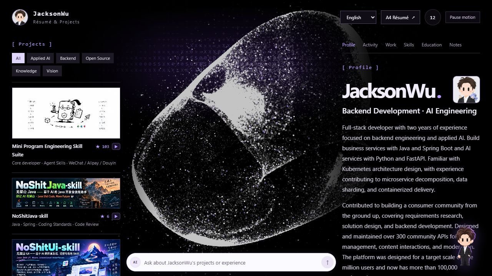

# `JacksonWu`

### AI Application Engineer · Backend Systems Builder

`models are components. systems are the product.`

## Personal Website

[Visit my personal website](https://wzj1228516103.github.io/jackson-wu-portfolio/?lang=en)

Explore my projects, view my printable résumé, or ask the streaming AI chat
about my work. After each reply, the chat suggests questions to ask next.

## Open Source

**Resume Portfolio** is a reusable template for building a personal website and
printable A4 résumé. It includes a self-hosted portfolio agent with streaming
chat and configurable follow-up questions. [Source code](https://github.com/wzj1228516103/resume-portfolio) · [Live demo](https://wzj1228516103.github.io/resume-portfolio/)

## About Me

I am a backend developer focused on applied AI engineering.

I work on the layer where an LLM stops being a demo and becomes a product:
stateful Agent workflows, retrieval pipelines, business tools, real-time
transport, service boundaries, and deployment.

My main playground is the intersection of AI applications and connected
devices. I build with Python and Java, usually pairing FastAPI AI services
with Spring Boot business systems.

## Toolbox

`Python` `Java` `FastAPI` `Spring Boot` `LangChain` `LangGraph`
`RAG` `Chroma` `Redis` `RabbitMQ` `MySQL` `WebSocket` `MQTT`
`Docker` `Kubernetes` `AWS`

Open to conversations about AI applications, Agent engineering,
backend systems, and open-source collaboration.
